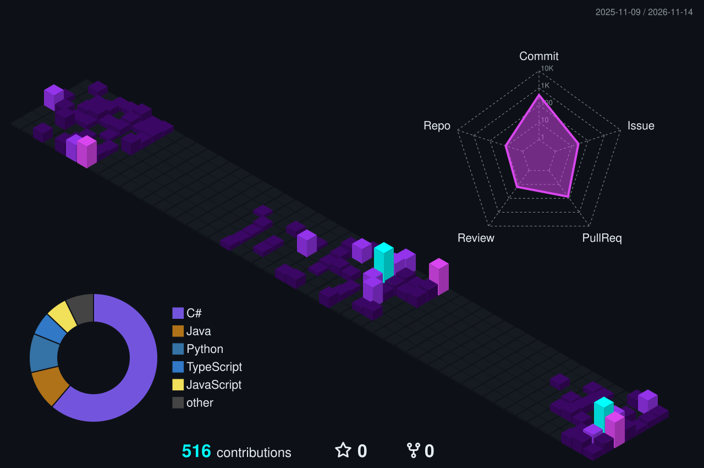

<div align="center">

  <a href="https://git.io/typing-svg">
    
  </a>

  <p>
    <a href="mailto:hinduck3206@gmail.com"></a>
    <a href="https://github.com/quackii00"></a>
    
  </p>

</div>

---

### About

```yaml
name: Ngọc Huyền (Quackii)
education: Software Engineering @ UIT (VNU-HCM)
focus: Frontend Development (React, TypeScript, Tailwind CSS) & UI/UX
beyond_code: Sad playlists, iced matcha & spontaneous chaos
motto: "Making the UI look pretty so nobody notices the console errors."
```

---

### Tech Stack

<div align="center">
  
</div>

---

### Selected Projects

| Project | Description | Stack |
| :--- | :--- | :--- |
| **AlgoLearner** | Online Judge & LMS platform with interactive code editor, custom UI mascots, and role-based dashboards | `React` `TypeScript` `Tailwind CSS` `Spring Boot` |
| **[EasyFlips](https://github.com/SyNguyen3107/EasyFlips)** | Anki-inspired flashcard & multiplayer study app with real-time lobby and cloud sync | `C#` `WPF (.NET 8)` `SQLite` `Supabase` |
| **[2D Music Platformer](https://github.com/wvltunes/SE102-Group-3)** | Rhythm-based 2D platformer game with audio-synchronized mechanics | `Unity` `C#` |

---

### Contributions

<div align="center">

  

  

</div>
